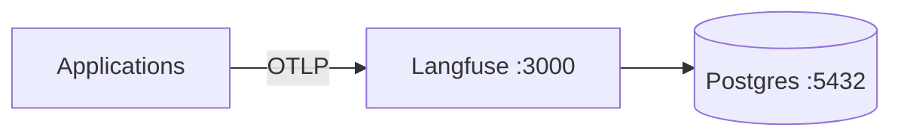

# observability — Architecture

> **Layer**: X 横切框架  
> **Role**: 可观测性栈 — Langfuse OSS + Postgres  
> **Stack**: Docker Compose  
> **Health**: Infrastructure-only, no code tests
>
> 系统全景参见：[`docs/ARCHITECTURE-DIAGRAM.md`](../docs/ARCHITECTURE-DIAGRAM.md)

---

## 1. 内部架构



## 2. 入口

| Type | Entry | Port / Notes |
|:--|:--|:--|
| Docker | `docker compose up` | Langfuse Web :3000, Postgres :5432 |

## 3. 核心模块

| Module | Responsibility |
|:--|:--|
| `docker-compose.yml` | Langfuse + Postgres 15 deployment |

## 4. 测试

```bash
cd projects/observability && docker compose up -d
```
