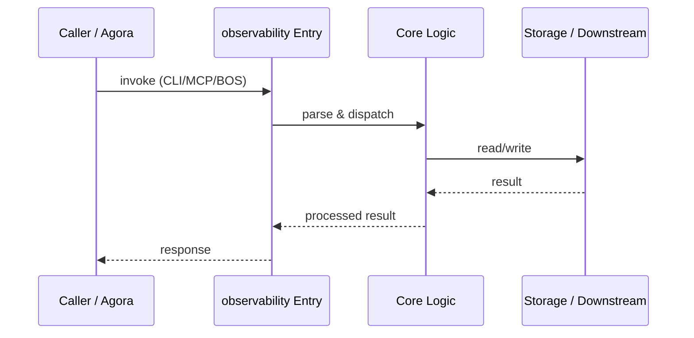

# observability — Call Chain

> 本文档描述 observability 内部最核心的一条调用链 / 数据流。
>
> 通用跨层调用链参见：[`../../docs/I0-AGORA-CALLCHAIN.md`](../../docs/I0-AGORA-CALLCHAIN.md)

---

## 关键路径

1. 1. `docker compose up` starts Postgres and Langfuse containers
2. 2. Langfuse Web exposed on :3050
3. 3. Postgres exposed on :5432 for external traces
4. 4. kairon sends OTLP traces to Langfuse

## Sequence Diagram

